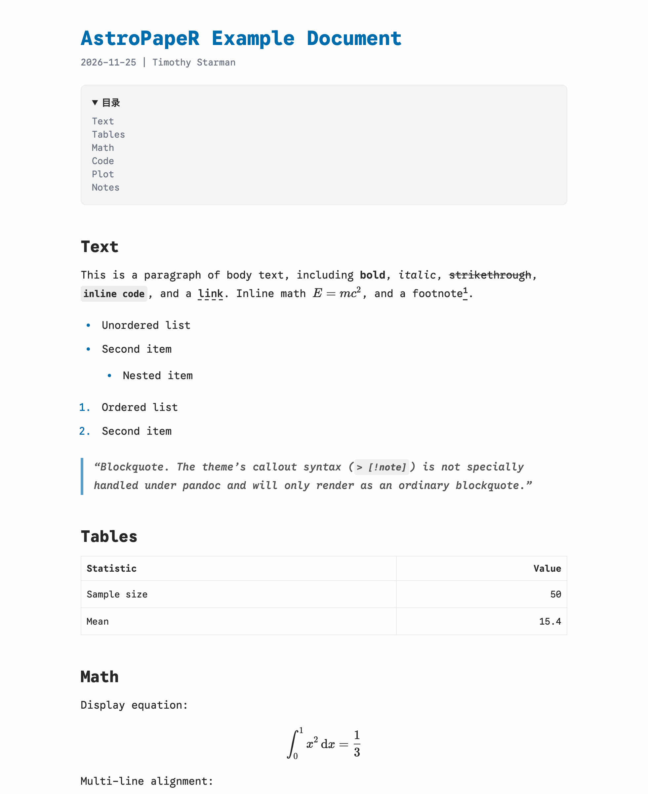
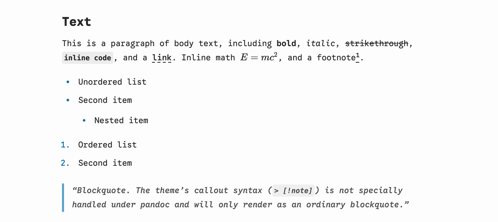
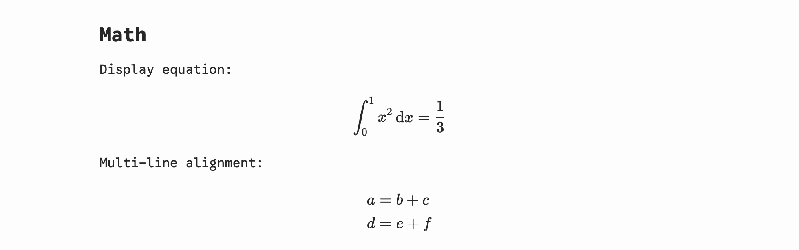
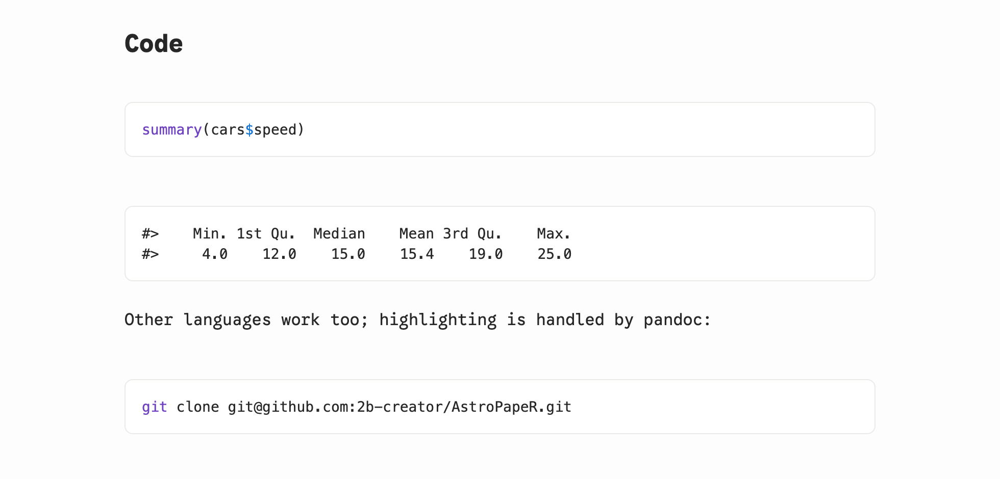
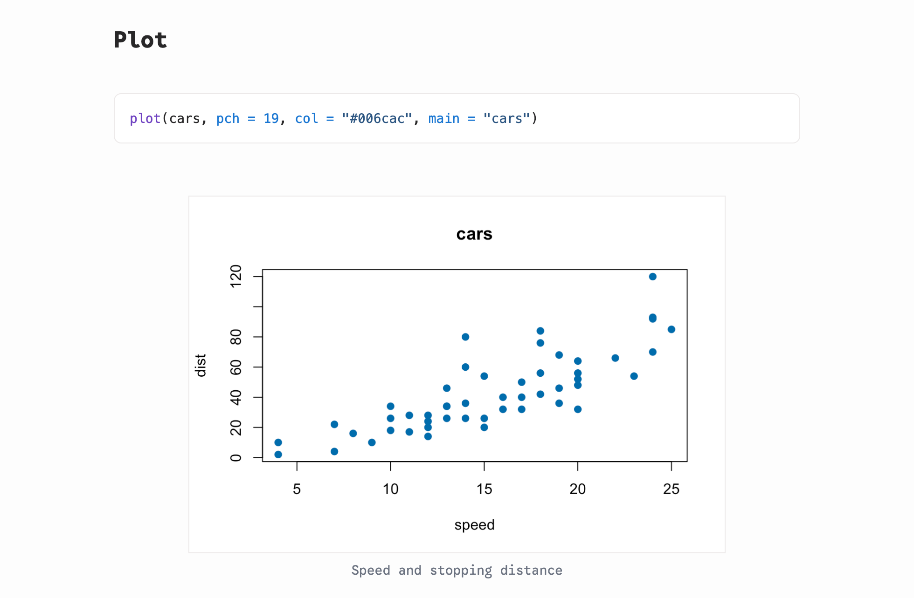

# AstroPapeR

An R Markdown output format that renders documents with the
[AstroPaper](https://github.com/satnaing/astro-paper) look: Tailwind typography,
Google Sans Code, KaTeX math, an optional table of contents and a `min-light`
code palette.

> 中文说明: [doc/readme-zh.md](doc/readme-zh.md)

## Gallery



| | |
|---|---|
|  |  |
|  |  |

## Install

```r
install.packages("devtools")
library(devtools)
install_github("2b-creator/AstroPapeR")
```

## Use

```yaml
---
title: "My post"
output: astropaper::astropaper
---
```

Or as a function:

```r
rmarkdown::render("post.Rmd", output_format = astropaper::astropaper())
```

RStudio users get the format under *File > New File > R Markdown > From
Template > AstroPaper HTML*.

Useful arguments:

```r
astropaper(
  toc = TRUE,
  toc_depth = 3,
  self_contained = TRUE,   # single portable HTML file
  highlight = NULL,        # NULL = bundled min-light theme
  css = "extra.css"        # appended after the bundled stylesheet
)
```

A complete example covering text, tables, math, code and plots lives in
[`doc/sample.Rmd`](doc/sample.Rmd).

## Customise

| Want to change | Where |
|---|---|
| Colours, fonts, spacing tokens | `inst/css/src/theme.css`, then rebuild |
| Prose typography | `inst/css/src/typography.css`, then rebuild |
| Page structure | `inst/templates/astropaper.html` |
| Code colours | `inst/themes/astropaper.theme` (a pandoc highlight theme) |

Rebuild the stylesheet after editing `inst/css/src/`:

```sh
npm install --no-save tailwindcss @tailwindcss/typography
tools/build-css.sh
```

The compiled `inst/css/astropaper.compiled.css` is what the package ships, so
end users never need Node.

The full walkthrough — tokens, typography, template structure, syntax
highlighting, fonts and troubleshooting — is in the customisation guide:
[English](doc/customize.md) · [中文](doc/customize.zh.md).

## Contributing

Bug reports, feature requests, documentation fixes and translations are welcome.
[`CONTRIBUTING.md`](CONTRIBUTING.md) covers the development setup, how the CSS
build works, the testing commands and the release checklist; a Chinese version is
available as [`CONTRIBUTING.zh.md`](CONTRIBUTING.zh.md).

## Notes

- Fonts (Google Sans Code) and KaTeX are loaded from CDNs at view time. With
  `self_contained = TRUE`, pandoc warns that it cannot fetch them; the links
  are kept and the document still renders when online.
- Math uses KaTeX; `math_method` is passed through to
  `rmarkdown::html_document()`.
- `html_document()` is exported as an alias; `library(astropaper)` masks
  `rmarkdown::html_document()`, so prefer the `astropaper::` prefix.
