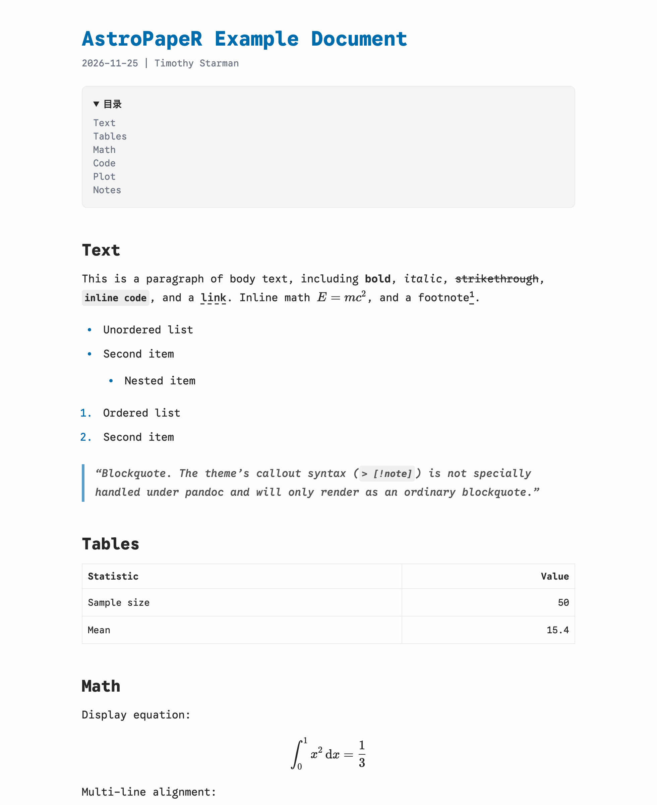
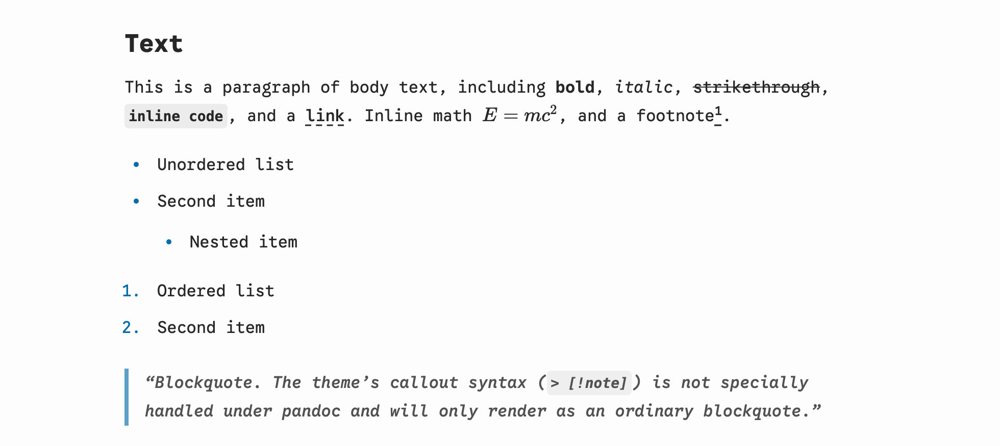
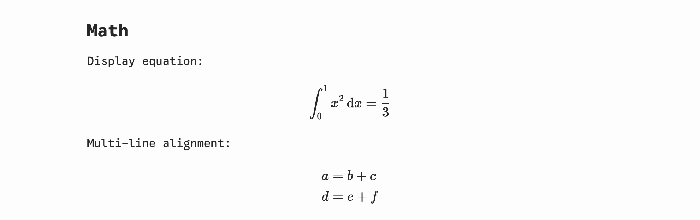
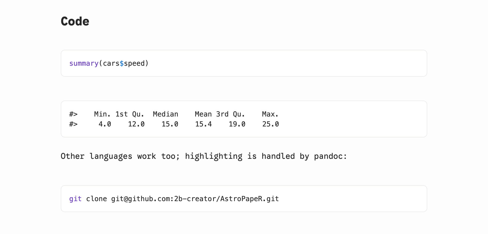
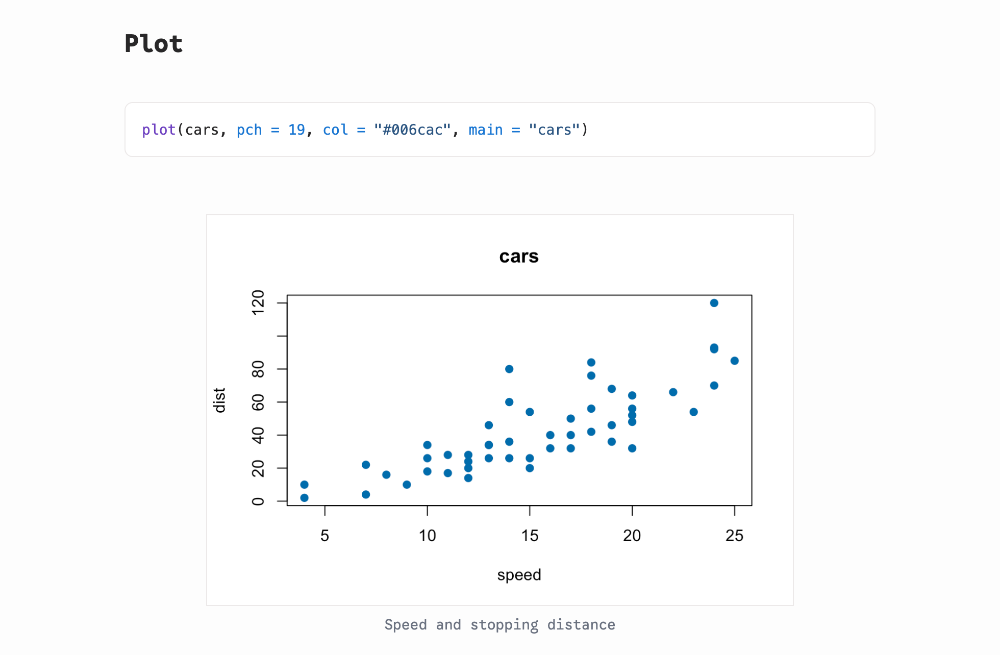

# AstroPapeR

一种 R Markdown 输出格式，渲染出 [AstroPaper](https://github.com/satnaing/astro-paper)
风格的文档：Tailwind 排版、Google Sans Code 字体、KaTeX 数学公式、可选目录，以及
`min-light` 代码配色。

> English: [README.md](README.md)

## 示例



| | |
|---|---|
|  |  |
|  |  |

## 安装

```r
install.packages("devtools")
library(devtools)
install_github("2b-creator/AstroPapeR")
```

## 使用

```yaml
---
title: "My post"
output: astropaper::astropaper
---
```

或作为函数调用：

```r
rmarkdown::render("post.Rmd", output_format = astropaper::astropaper())
```

RStudio 用户可以在 *File > New File > R Markdown > From Template > AstroPaper HTML*
里找到这个格式。

常用参数：

```r
astropaper(
  toc = TRUE,
  toc_depth = 3,
  self_contained = TRUE,   # 单个可移植的 HTML 文件
  highlight = NULL,        # NULL = 内置 min-light 主题
  css = "extra.css"        # 追加在内置样式表之后
)
```

覆盖文本、表格、数学、代码和图形的完整示例见 [`doc/sample.Rmd`](doc/sample.Rmd)。

## 自定义

| 想改什么 | 改哪里 |
|---|---|
| 颜色、字体、间距等 token | `inst/css/src/theme.css`，然后重新构建 |
| 正文排版 | `inst/css/src/typography.css`，然后重新构建 |
| 页面结构 | `inst/templates/astropaper.html` |
| 代码配色 | `inst/themes/astropaper.theme`（一个 pandoc 高亮主题） |

编辑 `inst/css/src/` 之后重新构建样式表：

```sh
npm install --no-save tailwindcss @tailwindcss/typography
tools/build-css.sh
```

包发布的是编译后的 `inst/css/astropaper.compiled.css`，所以最终用户不需要装 Node。

完整走查——token、排版、模板结构、代码高亮、字体、常见问题——见自定义指南：
[English](doc/customize.md) · [中文](doc/customize.zh.md)。

## 贡献

欢迎提交 bug、功能请求、文档修正和翻译。开发环境、CSS 构建方式、测试命令和发布
清单都写在 [`CONTRIBUTING.zh.md`](CONTRIBUTING.zh.md)（[English](CONTRIBUTING.md)）。

## 说明

- 字体（Google Sans Code）和 KaTeX 在查看时从 CDN 加载。使用 `self_contained = TRUE`
  时，pandoc 会警告无法抓取这些资源；链接会保留，联网查看一切正常。
- 数学公式由 KaTeX 渲染；`math_method` 会原样传给 `rmarkdown::html_document()`。
- `html_document()` 作为别名导出；`library(astropaper)` 会遮蔽
  `rmarkdown::html_document()`，所以推荐用 `astropaper::` 前缀。
